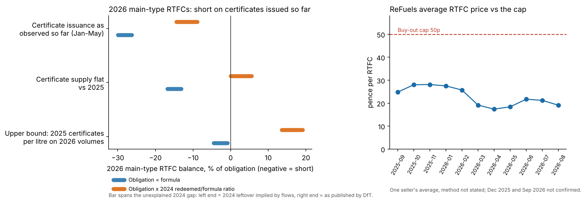
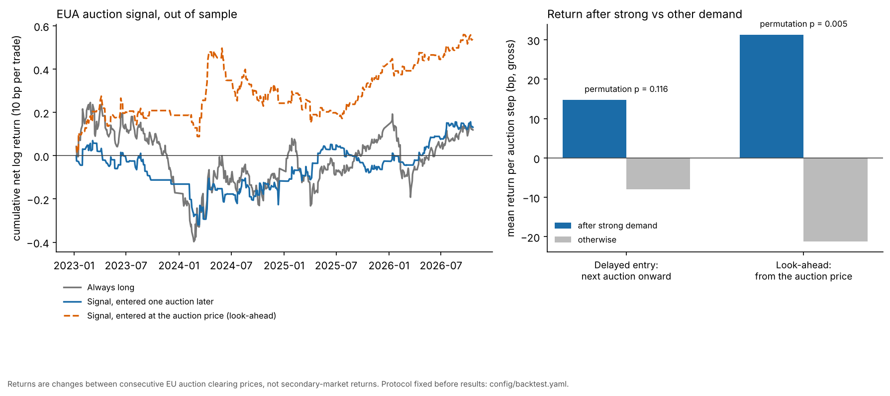

# UK RTFO & EU ETS Compliance Desk

Public-data monitors for two compliance markets:

1. **UK RTFO balance monitor**: are Renewable Transport Fuel Certificates (RTFCs) in surplus or deficit this year, and how close is the price to the buy-out cap?
2. **EU ETS auction signal**: does EEX primary auction demand say anything about the next auction price, once costs are included?

> **Status:** work in progress (v1 target: 9 Nov 2026). Done so far: RTFO, EEX auction and RTFC price-proxy data pipelines, and the RTFO balance monitor. The EUA auction backtest is a null result (below).

## Headline: RTFO balance monitor



Unresolved, and possibly an artefact of reporting lag. On the certificates issued so far (Jan to May 2026), main-type RTFCs look short: -9% to -30% of the formula obligation, but 2026 periods are only about three months old while the 2025 comparison periods were read much later. The price (19.1p in August 2026, 38% of the 50p cap, below a year earlier) does not look like a market that short, so either issuance is lagging or the obligation is lower than the formula implies, and the public data cannot tell which. DfT's own 2024 balance table also has an unexplained 328m-certificate gap. Method, assumptions and what would change the view: [docs/rtfo_monitor.md](docs/rtfo_monitor.md). Run it with `make monitor`.

## Headline: EUA auction signal



Does strong demand at one EEX auction predict later auction prices? **Not in a way I can show.** Out of sample (2023 to Oct 2026) the signal, entered one auction later so it has no look-ahead, earns +2.4bp per auction step after a 10bp cost against +2.2bp for always being long, with a permutation p-value of 0.116 against a pre-registered 0.05; the effect is inconclusive, not proven absent. It only looks strong if a position could be opened at the auction price after seeing the result, which the data cannot show. The protocol was written before the results were computed, but the squashed history here cannot show that order, so treat it as stated, not verifiable. Method and limits: [docs/eua_backtest.md](docs/eua_backtest.md).

## How to run

Requires Python 3.11+.

```bash
git clone https://github.com/u4154367347-maker/uk-rtfo-eu-ets-desk.git
cd uk-rtfo-eu-ets-desk
python -m venv .venv
source .venv/bin/activate      # Windows: .venv\Scripts\activate
make install   # or: pip install -e ".[dev]"
make data      # or: python -m desk.pipeline
make test      # or: python -m pytest
```

`make data` downloads each file listed in [`config/sources.yaml`](config/sources.yaml), checks it against a pinned SHA-256, and stops if gov.uk has replaced the file. Downloaded files are cached in `data/raw/` (not committed). What was downloaded, from where and when is written to [`data/provenance.json`](data/provenance.json).

## Data sources

| Dataset | Publisher | Releases used | Format | Access |
|---|---|---|---|---|
| [RTFO statistics data tables (RF_01)](https://www.gov.uk/government/statistical-data-sets/renewable-transport-fuel-obligation-rtfo-statistics-data-tables) | UK Department for Transport | 2024 final (revised), 2025 fifth provisional, 2026 first provisional | ODS | Free, no account |
| [EEX EUA primary auction results](https://www.eex.com/en/market-data/market-data-hub/environmentals-data) | European Energy Exchange | History 2012-2025 (zip of yearly workbooks) and the current-year workbook | XLS/XLSX | Free, no account |
| [ReFuels monthly "Biomethane Station Data" press releases](https://refuels.com/news/) | ReFuels | Sep 2025 - Aug 2026 (11 releases) | CSV, curated by hand | Free; no download, read from the press release |


### RTFC price proxy

`data/manual/refuels_rtfc_prices.csv` has one row per monthly release: the average RTFC price in pence, the prior-year and prior-month figures when the release states them, the publication date, the URL, and **the exact sentence the number was read from**. `make data` validates it: every number must appear in its quote, prices must be between 0 and 50p (the main buy-out), the release must be published 0-60 days after the month ends, and a later release that restates the previous month must agree with that month's own release.

**Limitations:** this is one seller's number, not a market index. ReFuels sells biomethane certificates and says it sold its 2026 volume forward at around 25-26p, so its own realised price differs from spot. The releases do not say how the average is built (volume-weighted or not, spot or forward). It covers main-obligation RTFCs only, not development RTFCs. December 2025 and September 2026 are **not confirmed** (release not found), so they are not in the file.

To add a month: append a row, copy the sentence exactly, run `make test`.

### RTFO tables produced

| File | DfT table | Contents | Unit |
|---|---|---|---|
| `rtfo_volumes.parquet` | RF_0101 | Fuel supplied by fuel type and monthly supply period | million litres (equivalent) |
| `rtfo_certificates_issued.parquet` | RF_0102 | RTFCs issued and related volumes by certificate category | million certificates / litres |
| `rtfo_balances.parquet` | RF_0103 | RTFCs issued, revoked, redeemed and still in existence, by obligation period | million certificates |
| `rtfo_transfers.parquet` | RF_0104 | RTFCs transferred by quarter and account type (supplier/trader) | million certificates |
| `rtfo_obligation_performance.parquet` | RF_0107 | Share of each obligated supplier's obligation met with certificates vs buy-out (final releases only) | fraction |

### EEX table produced

| File | Contents | Unit |
|---|---|---|
| `eex_auctions.parquet` | One row per primary auction since 2012: price, bid range, volume, total bids, cover ratio, bidders, revenue, country/platform, status | EUR/tCO2, tCO2, EUR |

The RTFO tables are in long format with `release`, `release_status`, `data_as_of` and `table_id` columns, so values from different releases can be compared. Rows that are totals in the source are kept and flagged with `is_total`.

### Things to know about the data

- **EEX: several auctions run on the same day.** The EU common platform, Germany, Poland and others hold separate auctions with their own prices and volumes; filter on `country` (`EU` is the common platform) before using prices as a time series. Aviation contracts (`EAA2`, `EAA3`) are in the file too; `is_eua` marks the EUA ones.
- **EEX: cancelled auctions** have no price (`status = cancelled`). Before 2020 the files have no status column.
- **EEX: the current-year workbook changes after every auction**, so it is downloaded fresh on every run and not checksum-pinned; the 2012-2025 archive is pinned. Re-running next week can therefore add rows.
- **EEX column layouts changed between years**, so columns are matched by name, not position. Each auction is checked: cover ratio = total bids / volume, revenue = price x volume, and the price lies inside the bid range. All 3,000+ auctions pass.

- **Provisional data is incomplete.** The 2026 first provisional release uses information received by DfT up to 3 September 2026, and late supply periods show zero. The final 2026 figures are due in November 2027.
- **Supply periods are not calendar months.** They run from the 15th of one month to the 14th of the next (January starts on the 1st, December ends on the 31st).
- **Renewable gases are converted to litres** with the RTFO Order factors (1.9 for biomethane, 1.75 for biopropane).
- **RF_0107 shares are per supplier**, not weighted by supplier size.
- **The parser checks every published total** against the sum of its components and fails on any mismatch. One mismatch exists in DfT's own 2024 final file (RF_0103, revoked certificates for 2023: components add to 73.89m, the total says 73.93m; later releases correct the component). It is documented in `config/sources.yaml` and allowed explicitly.

## Repository layout

```
config/sources.yaml     source URLs and pinned checksums
src/desk/io.py          download, cache, checksum, provenance
src/desk/rtfo.py        RF_01 parsers with totals checks
src/desk/eex.py         EEX auction parser with per-auction checks
src/desk/refuels.py     validation of the hand-curated RTFC price CSV
src/desk/pipeline.py    `make data` entry point
src/desk/monitor.py     RTFO balance monitor (`make monitor`)
src/desk/backtest.py    EUA auction backtest (protocol: config/backtest.yaml)
src/desk/charts.py      headline charts
config/rtfo_obligation.yaml  obligation percentages and buy-out prices (with source)
docs/                   monitor write-up and chart
data/manual/            hand-curated inputs (ReFuels RTFC prices)
data/processed/         cleaned parquet files (committed)
data/provenance.json    what was downloaded, when, and its checksum
tests/                  offline tests on a cut-down real RF_01 file
```

## License

MIT
