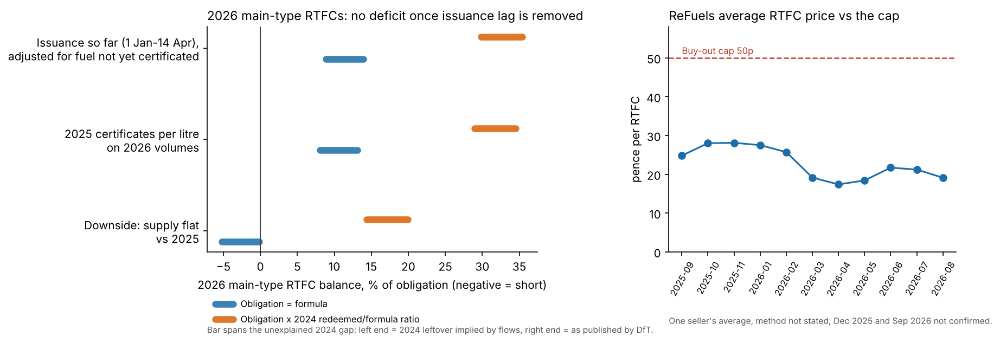

# RTFO balance monitor: is the 2026 main obligation long or short?

Data: DfT RF_01 tables (2024 final; 2025 and 2026 provisional, 2026 data as of 3 Sep 2026), DfT RTFO Compliance Guidance 2026, ReFuels monthly releases.
Numbers below come from [`data/processed/rtfo_monitor.json`](../data/processed/rtfo_monitor.json), built by `python -m desk.monitor`. Units are million certificates unless stated.

## Short answer (a hypothesis, not a forecast)

**Once issuance lag is removed, the public data show no 2026 main-type deficit: the balance is -5% to +35% of the obligation across the 12 cases, and +9% to +35% in the case built on issuance so far.** That fits the price: the ReFuels average was 19.1p in Aug 2026, 38% of the 50p cap and below the 24.9p of Aug 2025.

**Why an earlier version of this page said "short", and why that was wrong.** Raw main-type issuance for supply periods 0-3 (1 Jan to 14 Apr) is 15.8% below 2025. But DfT's own RF_0102 says only 70% of 2026 renewable fuel in those periods has had certificates issued so far (53% in period 3), against 93% for the same 2025 periods. Per certificated litre, issuance is unchanged (1.72 main RTFCs per litre in both years). Scaled to all the fuel supplied, issuance is **+15.7%**, in line with renewable fuel supplied (+16.8% over the same periods). The -15.8% is reporting lag, not a supply drop; it is kept in the JSON as `raw_growth` with `raw_comparable: false`.

**The 2025 base is incomplete too.** The 2025 fifth provisional release has certificates for 92.0% of 2025 renewable fuel; the 2024 final release reached 99.2%. The model scales 2025 net main-type issuance (5,402.3 as published) by 99.2/92.0 = 1.078, to 5,825.5. Without that scaling the issuance-based case is -3.8% to +19.9%: still no clear deficit.

**What would change this view**
- Later 2026 releases: if certificates for the remaining 30% of fuel in periods 0-3 come in below the rate seen so far (certificates per litre falling), the adjusted case is too high.
- Recorded 2025 redemptions. The provisional files show none yet, so the 2025 close is modelled, not observed.
- DfT explaining the 2024 gap below (it moves the 2026 balance by about 5 points of the obligation).
- A price source better than one seller's average.

## 1. The 2024 gap

RF_0103 should satisfy issued - revoked - redeemed = still in existence. It does for 2021 and 2022 (to 0.01m) and breaks after that:

| Obligation period | Net issued | Redeemed | Existing (DfT) | Existing implied by flows | Gap |
|---|---|---|---|---|---|
| 2021 | 4,501.64 | 4,501.63 | 0.01 | 0.01 | 0.00 |
| 2022 | 5,498.71 | 5,498.64 | 0.07 | 0.07 | 0.00 |
| 2023 | 6,350.97 | 6,375.39 | 0.22 | -24.42 | +24.64 |
| 2024 | 6,675.75 | 5,769.55 | 1,234.21 | 906.20 | +328.01 |

What I checked:
- Net issued here equals RF_0102 (certificates issued by supply period) for 2024, 2025 and 2026, so the break is in redeemed or in existing, not in issued.
- Later releases repeat the same 2023 and 2024 figures; they are not revisions.
- Moving certificates between periods (carry-over) cannot explain it: that nets to zero across periods, but the total gap for 2021-24 is +352.65. Certificates carried in from before 2021 would fit, but the file has no 2020 data to test that. **Not confirmed**; the question needs DfT.
- It is also not confirmed whether "redeemed" is attributed by issue period or by obligation period. That is why the 90.8% ratio below is an empirical scaling, not a measured demand ratio.

The model runs both versions: 2024 leftover of 1,234 (as published) or 906 (implied by flows).

## 2. How the obligation is built

Obligation = percentage x obligated amount (DfT guidance paras 3.5-3.8, Table 1). The obligated amount is fossil fuel plus non-sustainable eligible fuel; the model uses RF_0101 "Total fossil fuel" as the proxy, which includes 2,327m litres of low sulphur gas oil (5.1% of the 2024 proxy). Percentages (main / development): 2024 13.563 / 1.379, 2025 14.054 / 1.619, 2026 14.552 / 1.863. All three rows were checked against Table 1 of the PDF.

**2024 check (last final year):** formula obligation 6,196.9 vs 5,627.9 main-type certificates redeemed, a ratio of 0.908. The cause is unknown from public data: buy-out, the definition of the obligated amount (0.957 without low sulphur gas oil), or carry-over timing. RF_0107 says 18 of 20 obligated suppliers met the main obligation fully with certificates, but that count is unweighted by supplier size, so it does not settle this. The calibrated cases scale the obligation by 0.908 in **both** 2025 and 2026.

## 3. 2025 close (modelled)

Supply = 2025 net main-type issuance scaled for fuel not yet certificated (5,402.3 x 1.078 = 5,825.5) + 2024 leftover, with carry-over capped at 25% of the obligation.

| Demand | 2024 leftover | Obligation | Balance | Carried into 2026 |
|---|---|---|---|---|
| Formula | published (1,234) | 6,396.3 | +663.1 (+10.4%) | 663.1 |
| Formula | implied (906) | 6,396.3 | +335.1 (+5.2%) | 335.1 |
| x0.908 | published | 5,809.0 | +1,250.4 (+21.5%) | 1,250.4 |
| x0.908 | implied | 5,809.0 | +922.4 (+15.9%) | 922.4 |

Only 2025-issued certificates can carry into 2026; 2024 ones expire after the 2025 obligation. The 25% cap applies to a supplier's own obligation (guidance paras 3.12 and 5.40), but the model applies it to the market total, which is generous to supply.

## 4. 2026 scenarios (12 cases)

Obligation: 14.552% x 2025 fossil volume x (1 - 1.9%), the year-to-date change in fossil supply (supply periods 0-6). Formula obligation 6,497; calibrated obligation 5,900. Three supply cases on the adjusted 2025 main-type issuance (5,825.5):

| Supply case | Main supply | Balance range across the 4 demand/leftover combinations |
|---|---|---|
| Issuance so far, adjusted for fuel not yet certificated (+15.7%) | 6,739 | +8.9% to +35.4% |
| 2025 certificates per litre on 2026 renewable volumes (+14.8%, periods 0-6) | 6,686 | +8.1% to +34.5% |
| Downside: flat vs 2025 | 5,826 | -5.2% to +19.9% |

These are corner cases, not a confidence interval; they are correlated. The first two agree because the adjusted issuance and the volume growth measure the same thing. Only the downside case with the formula obligation shows a deficit, worth at most about GBP 168m at the 50p buy-out.

**Development (modelled):** the 2026 target is 832 dRTFC (1.863% of the obligated amount). Supply is held at the published 2025 level of 263, because year-to-date development volumes are too lumpy to scale, and it is not scaled for lag, so the shortfall of 569 (about GBP 455m at the 80p buy-out) is an upper estimate. In 2024 the target was about 630 and 142 net certificates were issued, so roughly three quarters went to buy-out. dRTFCs can also meet the main obligation (guidance para 3.22), but with the development target unmet each dRTFC avoids an 80p buy-out against 50p for a main certificate, so the model keeps them for the development target.

## 5. Price

ReFuels average RTFC price: 19.1p in Aug 2026 (24.9p in Aug 2025), 38% of the 50p cap; 17.4p in Apr 2026 was the low of the series and 28.1p in Nov 2025 the high. It is one seller's average with an unstated method, covers main RTFCs only, and ReFuels says it sold its 2026 volume forward at about 25-26p. December 2025 and September 2026 are not confirmed. This series cannot choose between the model cases; it only shows that a deep deficit is not visible in it.

## Limits

- Fossil volume stands in for the obligated amount; 2025 and 2026 volumes are provisional.
- Issuance so far covers supply periods 0-3 (1 Jan to 14 Apr). The lag adjustment assumes fuel not yet certificated earns certificates at the same rate per litre as fuel already certificated; supply periods run from the 15th to the 14th.
- The relevant-crop cap (3.00%) is recorded in the config but not modelled.
- Aggregate carry-over and aggregate redemption ignore who holds the certificates (non-obligated holders cannot redeem).
